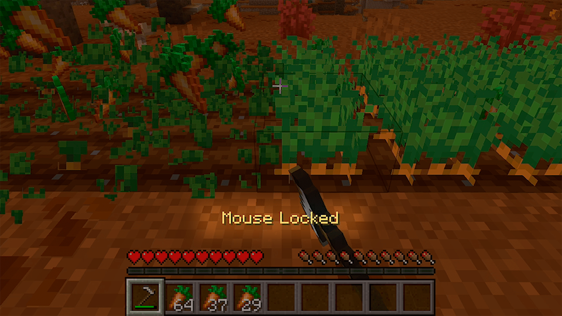
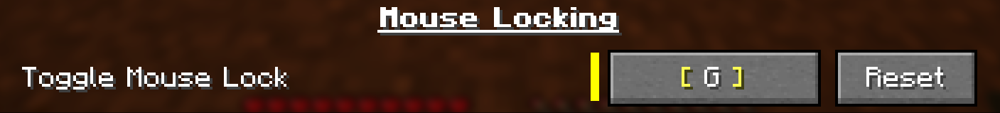
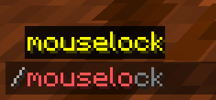
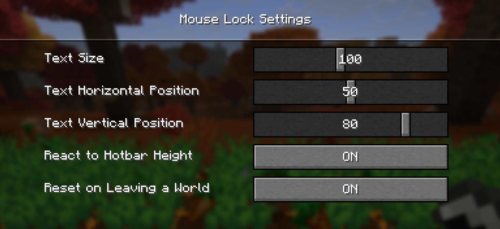

# Mouse Lock

This mod adds one single useful feature - locking your player's head rotation, **blocking mouse movement inputs** when told so.  
This is often used for low-interaction repetitive tasks where you need to go in a straight line, having set up the right angle in advance. The main expected usecase is different forms of farming or planting crops, but you can come up with new ways.

## Using the Feature

To turn the feature on or off, you can use a keybind or a command.

### With a Keybind

First of all, set a keybind of your choosing (**not set by default**), and then just press it when you need to lock your angle:

### With a Command

You can use `/mouselock` to lock or unlock the angle. It mostly exists for cases where you would need to trigger it with an another mod.

## Config/Settings

You can configrure the mod with `/mouselock settings` command or by finding the mod in the mod list and clicking the settings button.

**"Mouse Locked"** text overlay lets you change:
- It's size and position
- Whether it should lift up when hearts are visible
- Whether mouse lock should reset when leaving or changing worlds.

## Usage on servers

The mod just does the same thing as if you didn't move your mouse, which is quite possible, so it's should generally not cause issues, but, of course, it's your responsibility to be aware of a server's rules.

## Versions

The mod supports a lot of different versions. Most are backported, and such don't get active support - only the up-to date version does.

One more useful note is that the developer is not actively checking github issues (since they can't send notifications in any way), so those may get ignored even for months. Maybe there will be a discord server later to contact the dev easier.

You can still suggest useful changes or ideas for new features though (maybe for a separate mod), even on the issue tracker.  
Hope this mod helps someone :D

## Technical Information

This branch uses Temurin JDK 21 with automatic language level 17

**Refer to `master` branch for up-to-date documentation.**  
Downgraded versions don't have docs for obvious reasons

There is no guide on building the mod from scratch, but it should be trivial if you have done that before.  
